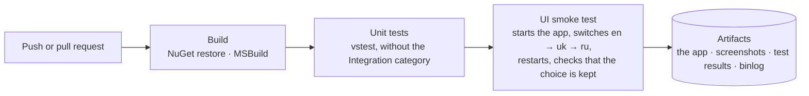

# Development

## Build locally (Windows)

Requirements:

* Windows 10 or 11 with **Visual Studio 2022** and the *.NET desktop development* workload (MSBuild and NuGet included).
* The **.NET Framework 4.8 targeting pack**. The *.NET desktop development* workload normally installs it; if it is missing, add it
  in the Visual Studio Installer under *Individual components*. Every project in the solution targets .NET Framework 4.8.

Build:

```powershell
nuget restore FleetAudit.sln
msbuild FleetAudit.sln -m -p:Configuration=Release
.\FleetAudit.App\bin\Release\FleetAudit.App.exe
```

`FleetAudit.Installer` (`.vdproj`, the MSI installer) is skipped by MSBuild. Build it with Visual Studio and the
*Microsoft Visual Studio Installer Projects* extension, either in the IDE or, after the MSBuild build above, from the command line:

```powershell
./build/Build-Installer.ps1                     # FleetAudit.Installer\Release\FleetAudit.Installer.msi
./build/Test-Installer.ps1 -MsiPath FleetAudit.Installer\Release\FleetAudit.Installer.msi   # elevated: install, smoke test, uninstall
```

## Tests

The tests are MSTest projects in `FleetAudit.Tests`:

| Folder | Covers |
| --- | --- |
| `Localization.Tests` | Resource parity across en/uk/ru, placeholders, XAML keys, no hard-coded Cyrillic, language switching and persistence |
| `Common.Tests` | Where `sys.dat` is stored (`%LocalAppData%\FleetAudit`): path resolution, folder creation, save and load. `WialonTokenStore`: encrypted round trip, no plain text in the file, unreadable file, fallback to the legacy `Token` setting. All use a temporary folder |
| `Configuration.Tests` | No Wialon token (or other 64+ hex-digit value) in any `.cs` or `.config` file; `App.config` keeps an empty `Token` key (the legacy fallback) |
| `Helpers.Tests` | Placeholder for the license-plate converter. It has no assertions yet. |
| `Excel.Tests`, `Wialon.Tests` | Tagged `Integration`: they need a live Wialon account or files on a developer machine. `Wialon.Tests` read the token from the `WIALON_TOKEN` environment variable and are inconclusive without it |

```powershell
vstest.console.exe FleetAudit.Tests\bin\Release\FleetAudit.Tests.dll /TestCaseFilter:"TestCategory!=Integration"
```

## No Windows machine? Use CI

Every pull request is built and tested on a GitHub-hosted Windows runner. You can work from macOS or Linux without a local
Windows setup:



| Workflow | Trigger | What it does |
| --- | --- | --- |
| [`windows-ci.yml`](../.github/workflows/windows-ci.yml) | push to `master`, every pull request, manual | Build, unit tests, UI smoke test. Uploads the ready-to-run app (`FleetAudit-Release`), a screenshot of every step, `.trx` results and the MSBuild binlog. A second job builds the MSI (version `0.0.<run number>`), installs it silently, runs the UI smoke test against the installed app and uninstalls it; it uploads the MSI (`FleetAudit-Installer-Release`) and the msiexec logs. |
| [`release.yml`](../.github/workflows/release.yml) | a `v*` tag, e.g. `v0.1.0` | Builds the app, stamps the tag into the MSI version, builds and tests the MSI as above, then publishes a GitHub release with the MSI and a zip of the app. |
| [`readme-screenshots.yml`](../.github/workflows/readme-screenshots.yml) | the `update-screenshots` label on a pull request, or manual | Re-captures `docs/screenshots/*.png` from the running app and commits them to the pull request branch. Remove and re-add the label to run it again. |

All three workflows share the composite action [`.github/actions/build-solution`](../.github/actions/build-solution/action.yml).

## Releases

Push a tag such as `v0.1.0` and the **Release** workflow builds the solution and attaches `sap-wialon-fleet-audit-<tag>-win.zip`
to a GitHub release with generated notes.

## Screenshots

`docs/screenshots/*.png` are generated from the running app by the *README screenshots* workflow. `docs/screenshots/legacy/`
holds hand-made captures of the original Russian UI. Name new files in English, in lowercase with hyphens.

## UI automation scripts

The scripts in `build/` drive the real application through **Windows UI Automation**. They use no extra tools; they run in
Windows PowerShell 5.1.

| Script | Purpose |
| --- | --- |
| `UiAutomation.ps1` | Shared helpers: start and stop the app, find elements, select a language, take screenshots, dump the automation tree |
| `Invoke-UiSmokeTest.ps1` | The end-to-end language switching test that CI runs |
| `Capture-ReadmeScreenshots.ps1` | Fixed-size window screenshots for the README and these docs |

The scripts find controls by `AutomationProperties.AutomationId` (`SettingsButton`, `LanguageSelector`). Keep those ids when
you edit the views. Expected texts are read from the `.resx` files, so the scripts stay ASCII-only.

## Conventions

* MVVM with Prism. Views stay free of logic; view models derive from `ViewModelBase`.
* All UI text goes through resources. See [localization.md](localization.md).
* Data contracts are not translated: SAP column headers and Wialon field names.
* Tests that need external systems get `[TestCategory("Integration")]`.
